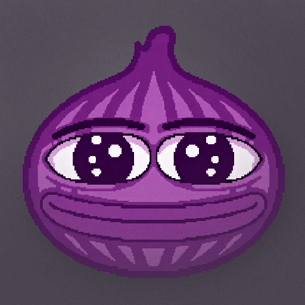

  

  
!!! Make sure to <b>click «install anyway»</b> !!!  
when a Play Protect dialog pops up during installation

Chatonion is a full vibecoded fork of [DankChat](https://github.com/flex3r/DankChat) by flex3r

---

### FEATURES

- Donation viewing and moderation window within the app  
- Refined, compact, and user-friendly UI  
- Caching for 7TV emotes and paints  
- Moderator settings for buttons in User profile cards (similar to Chatterino)  
- FFZ and BTTV emote modifiers, with controls for individual effects  
- Poll and prediction menus for voting, betting and moderatio (soon)  
- Ambilight effect, image previews in chat (kappa.lol, eblo.id, etc.), Shadow Chat, and more...

---

### CHATONION Developer

- Telegram: https://t.me/echpzdzh
- All links: https://bio.site/endychan

### DANKCHAT Developer

- Original: https://github.com/flex3r/DankChat
- Donate: https://streamelements.com/flex3rs/tip

*Support the DankChat development and get a dank badge next to your name*
